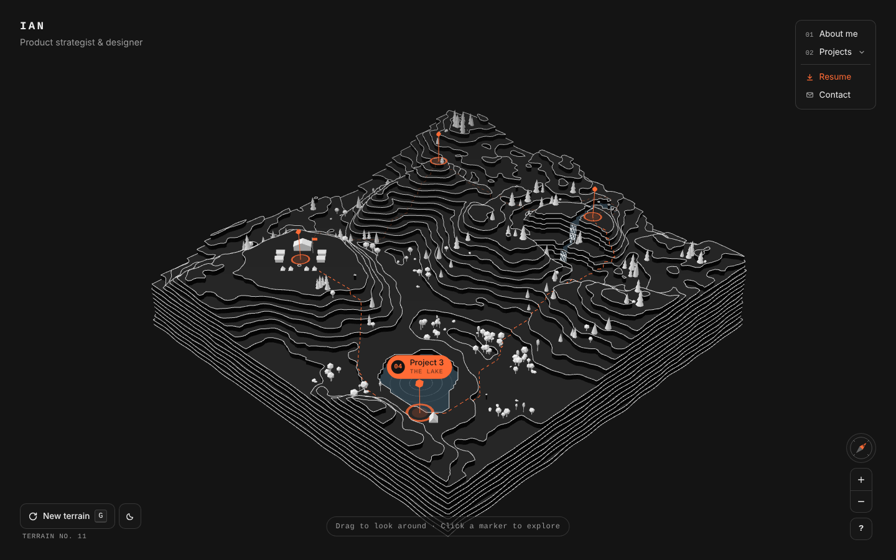

# IanSmith_Portfolio

Personal portfolio site for me to use while applying to jobs. The home screen is an interactive 3D topographic map.



A static site (plain HTML, CSS and JavaScript). There is no build step: GitHub Pages can serve these files as they are.

## Files

| File | What it does |
| --- | --- |
| `index.html` | Page structure, the section links (secondary navigation), the controls legend, and the text for each section. **Edit your copy here.** |
| `css/style.css` | Colours, type and layout. Colours are variables at the top. |
| `js/terrain.js` | Generates the stacked contour terrain. `seed` in `CONFIG` is the landscape the page opens with; the New terrain button (or G) picks a random one while keeping the landmarks in place. |
| `js/trails.js` | Plans each trail like a hiker would: avoids cliffs and water, prefers gentle ground, wanders a little. `WANDER` sets how much. |
| `js/sky-data.js` | The night sky: about 2,000 real stars and the constellation lines. Data from [d3-celestial](https://github.com/ofrohn/d3-celestial) by Olaf Frohn (BSD-3-Clause licence), based on the Hipparcos catalogue. |
| `js/main.js` | Camera, controls, markers, trails and the section panel. The `POINTS` list at the top sets where each place sits on the map. |

The 3D library (three.js 0.170.0) loads from a CDN via the `importmap` in `index.html`.

## Resume

Save your resume in this folder as `resume.pdf`. The Resume button and the Contact section both link to it.

## Adding or renaming a section

1. Add a link in the `<nav>` in `index.html`, e.g. `<a href="#project-4">`.
2. Add an `<article data-section="project-4">` inside the panel.
3. Add `{ id: 'project-4', label: 'Project 4', place: 'The overlook', kind: 'peak', quadrant: [1, 1] }` to `POINTS` in `js/main.js`. `kind` is the landform (`camp`, `peak`, `falls` or `lake`, one of each for now) and `quadrant` is the quarter of the map it wanders in. Spacing rules (`MIN_GAP`, `EDGE_MARGIN`) sit just below `POINTS`.

## Preview locally

Browsers block ES modules from `file://`, so run a tiny local server from this folder:

```
python3 -m http.server 8000
```

then open http://localhost:8000.

## Accessibility

- Every place on the map is also a normal link in the section nav, reachable with Tab.
- Keyboard: arrows orbit/tilt, WASD or Shift+arrows pan, + and - zoom, 1 to 4 jump to a place, R resets, Esc returns, ? toggles the legend.
- Opening a section moves focus to its heading; Esc returns focus to where you were.
- With "reduce motion" turned on, camera moves are instant and the markers stop pulsing.
- Without WebGL the page falls back to a plain document with all sections.

## Credits

Star positions, colours and constellation lines come from d3-celestial by Olaf Frohn, released under the BSD-3-Clause licence, which only asks that the credit above stays with the data. The sky is turned to match tonight's sky at about 40° north for the visitor's time zone.

## Publishing with GitHub Pages

1. In this repository on GitHub, open **Settings → Pages**.
2. Under **Build and deployment**, choose **Deploy from a branch**, pick `main` and `/ (root)`, then **Save**.
3. After a minute or two the site is live at `https://igneousid.github.io/IanSmith_Portfolio/`.
